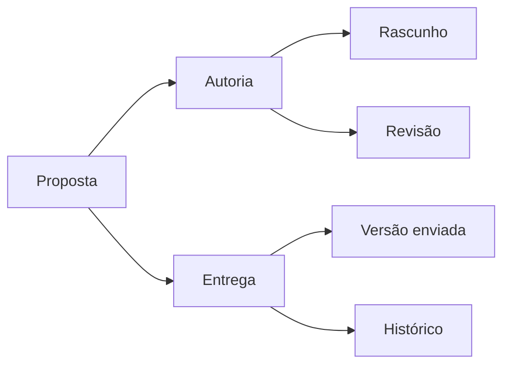
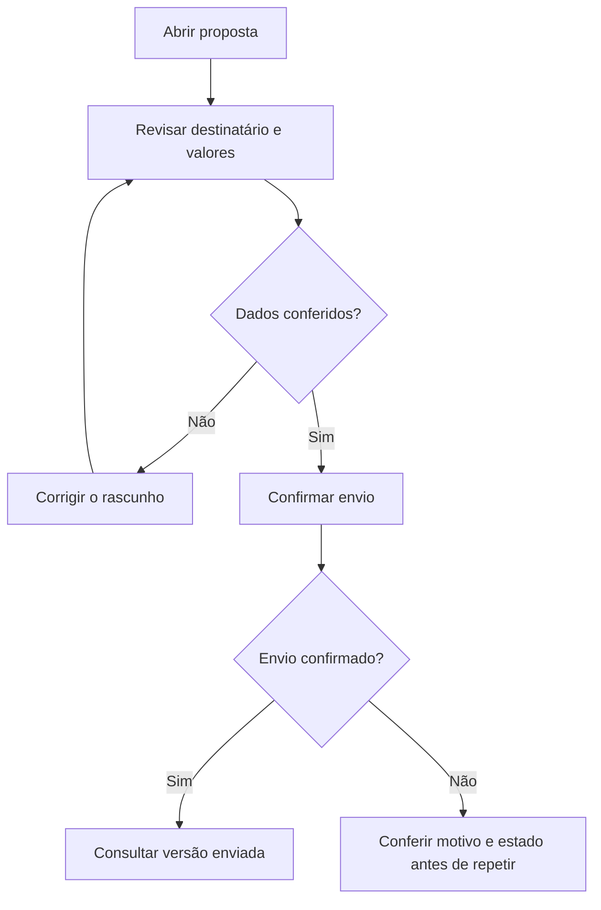
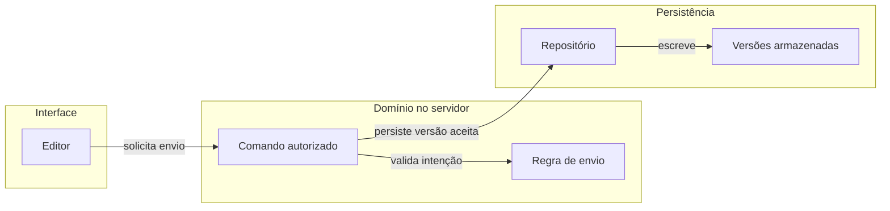
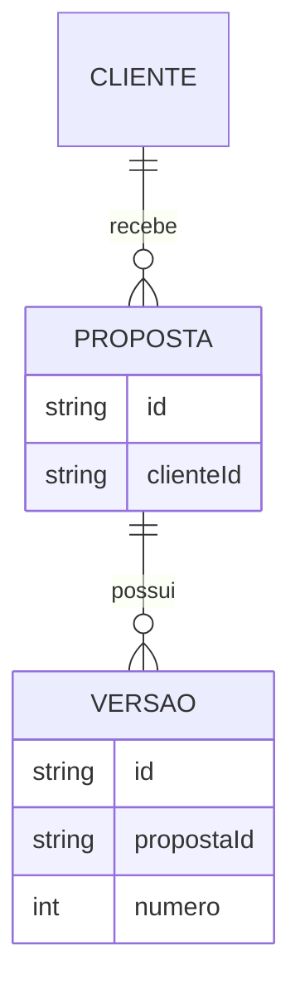
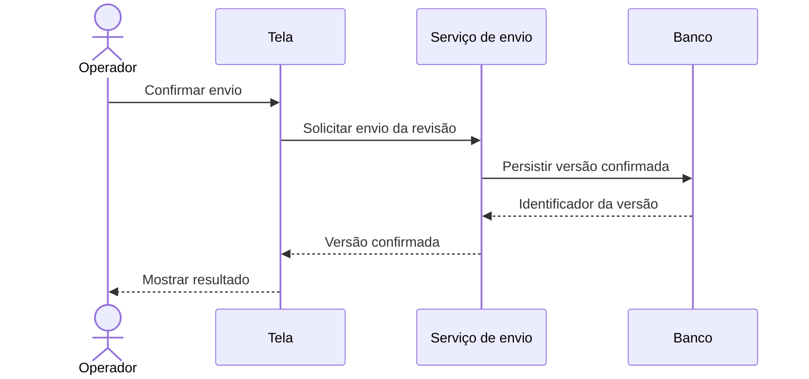
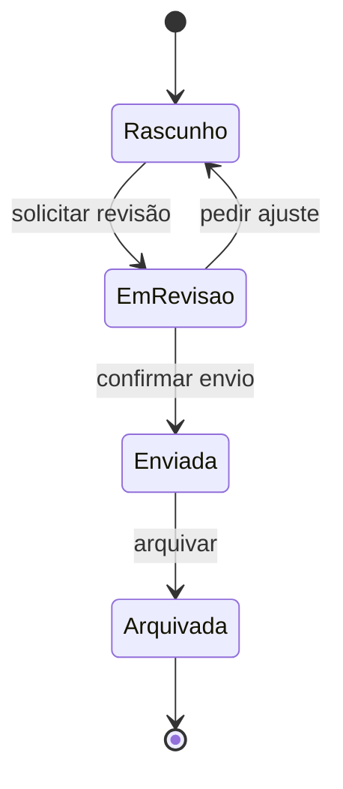
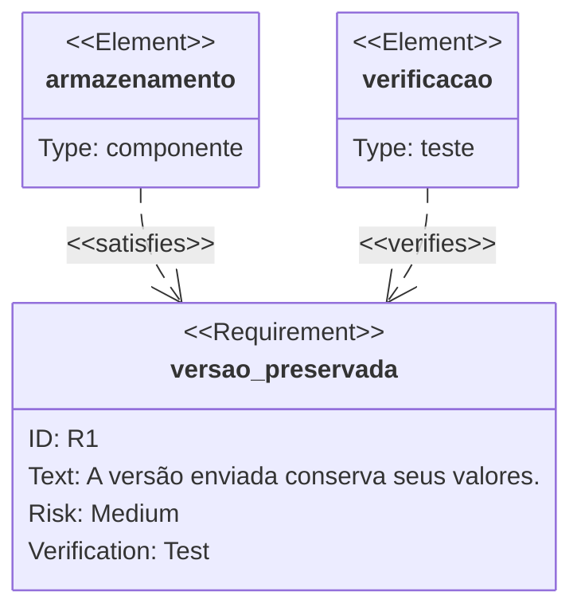

# Receitas Mermaid para explicar software

Playbook autocontido de diagramas. Os exemplos são fictícios e demonstram sintaxe e escolha didática; não documentam comportamento do DietFlow. Consulte a versão do renderizador de destino antes de afirmar suporte. Fonte editável permanece junto do conteúdo; imagem exportada é derivada.

## Mapa de conceitos

**Pergunta:** quais conceitos compõem este assunto e como se agrupam?

O “mind map” da receita usa flowchart controlado. Organize conceitos por responsabilidade, limite o recorte à pergunta e mantenha labels curtos. O formato mindmap nativo pode servir à exploração, mas não é a opção inicial quando layout e largura precisam ser previsíveis. A hierarquia conceitual não deve fingir ser árvore física de arquivos ou sequência temporal.

Para camadas, use subgraph e arestas rotuladas com relações reais. Árvores físicas de arquivos continuam em texto com responsabilidades. Divida mapas densos; cerca de 20 nós é um sinal de revisão de legibilidade, não autorização para eliminar relações importantes.

## Fluxo de tarefa e decisão

**Pergunta:** qual passo executar e como a escolha muda o resultado?

Comece pelo gatilho, mostre a decisão que altera o caminho e termine com resultado ou recuperação. Use passos numerados quando o caminho for linear; escolha flowchart quando a bifurcação for necessária à explicação. Não transforme cada chamada interna em uma caixa.

**Conferir:** ramos identificados, saída recuperável sem retry cego, resultado observável e decisões pertencentes ao mesmo nível de abstração. Exemplo fictício: confirmar quais estados e recuperações existem no produto real.

## Arquitetura em camadas

**Pergunta:** qual owner responde por apresentação, regra e persistência?

Use subgraph para fronteiras reais e rotule cada aresta. O mapa explica relações estáticas; a sequência opcional explica a ordem de uma operação. Não presuma que todo projeto contém estas mesmas peças.

**Conferir:** fronteiras client/server, responsabilidade da regra e autorização precisam de lastro real. Uma seta não significa que transação, entrega externa ou recuperação estejam implementadas. A prosa deve explicar essas propriedades quando pertinentes.

## Relações de dados

**Pergunta:** quais entidades se relacionam e quais cardinalidades importam?

Selecione entidades e campos necessários para compreender a regra. Declare cardinalidade e opcionalidade verificadas. Use uma tabela ao lado quando o verbo da relação ou a política de vínculo for importante; não dependa exclusivamente da legibilidade do label da aresta.

**Conferir:** entidades/campos existem? As cardinalidades representam constraints reais? Relação conceitual não foi descrita como foreign key sem lastro? O gráfico está limitado ao assunto, em vez de copiar o schema inteiro?

## Interação entre participantes — opcional

**Pergunta:** quem chama quem, em que ordem e onde ocorre o efeito?

Use sequenceDiagram quando a colaboração temporal for essencial. Nomeie papéis reais e distinga requisição de retorno. Represente assincronia, alternativas e erros somente conforme o comportamento examinado; setas visualmente diferentes precisam seguir a semântica da sintaxe escolhida.

**Conferir:** não apresentar esse exemplo fictício como receita universal de gravação. Autorização, conflitos e falhas precisam aparecer quando forem necessários para explicar a operação real. Se a dúvida é apenas decidir o próximo passo de uma pessoa, sequência pode adicionar participantes sem esclarecer o processo.

## Ciclo de vida — opcional

**Pergunta:** quais estados uma entidade assume e quais comandos permitem mudar de estado?

Modele uma entidade por vista. Use o vocabulário real do domínio, explicite transições e preserve voltas, bloqueios e estados terminais existentes. Tela aberta, tarefa do plano e estado de domínio são coisas diferentes; não misturá-los no mesmo lifecycle.

**Conferir:** estados e transições têm fonte? Estado visual de loading não virou estado persistido? Quem pode executar cada comando está explicado na prosa ou tabela quando essa diferença importa?

## Requisitos e evidência — uso seletivo

**Pergunta:** qual parte do sistema satisfaz um requisito e qual evidência realmente o verifica?

Use requirementDiagram quando a rastreabilidade justificar um gráfico. Formule requisito observável, mecanismo responsável e evidência existente. O desenho relaciona os elementos; não cria prova nem aprovação. Se o resultado ainda falta, marque como verificação planejada na prosa e não desenhe uma evidência inexistente como conclusão.

Este é um exemplo de relações de um sistema fictício, não um resultado de teste executado. Na aplicação real, nomeie a evidência disponível e o alcance observado. Não importar etapas PRD, SPEC, WARLOG, sprint ou CI do estudo original como rito obrigatório de documentação.

## Conferir e publicar

Antes de produzir o gráfico, escreva a pergunta e localize fatos suficientes para responder. Depois confira nós, relações, vocabulário, erros e limites; valide a sintaxe no renderizador pertinente e inspecione a imagem ao alegar legibilidade. Evite caixas com parágrafos, significados misturados, estilos por nó sem necessidade e gráficos sem conclusão didática.

A integração de um viewer Markdown, site MDX e drawer são capacidades distintas. Só inserir um bloco mermaid não comprova diagrama visual. Ao alterar suporte compartilhado, respeitar os componentes e a gramática do destino e seus consumidores. Converter PlantUML apenas quando pertinente e preservando significado; esta receita não autoriza migração global.
